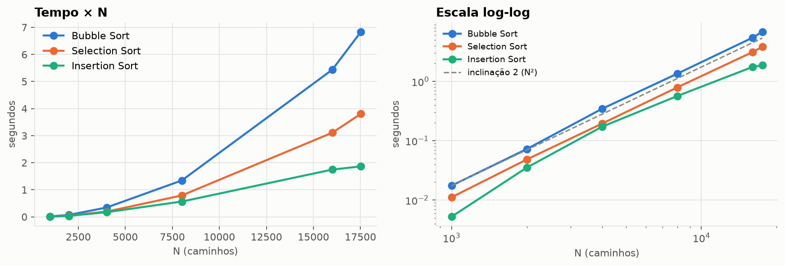
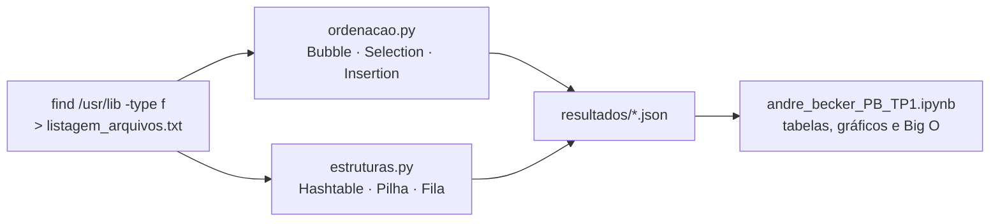
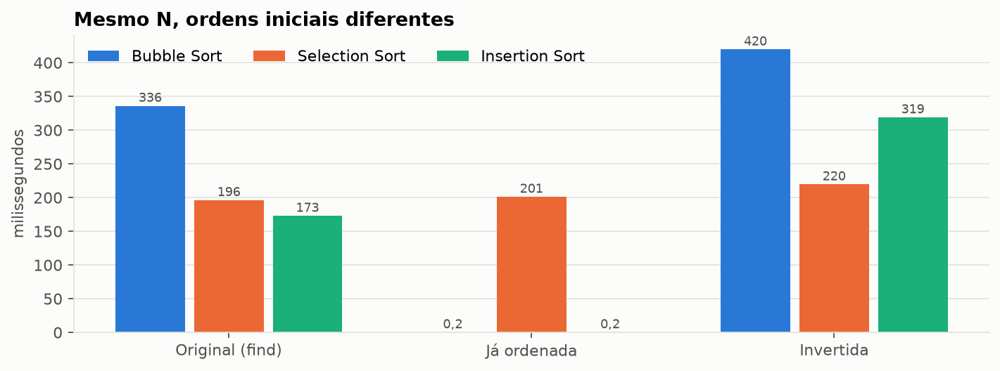
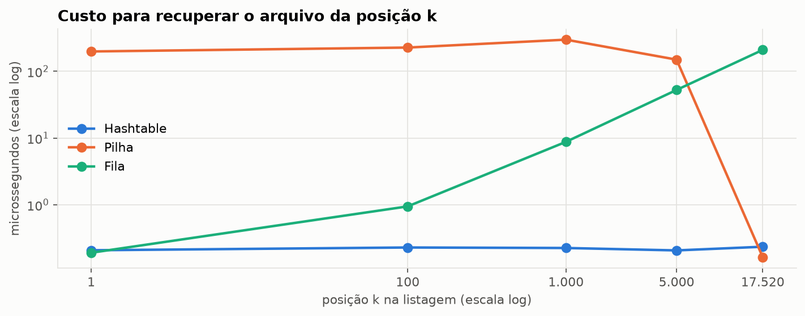

<div align="center">


# 🗂️ Listagem, Ordenação e Estruturas de Dados

**Do terminal Linux à análise Big O: 17.520 caminhos de arquivo ordenados com Bubble, Selection e Insertion Sort e armazenados em Hashtable, Pilha e Fila**

<sub>PB-TP1 · Bloco Ciência da Computação · Trabalho individual</sub>

<br/>

[](andre_becker_PB_TP1.ipynb)
[](https://nbviewer.org/github/andrebecker84/dr5-pb-tp1-ordenacao-estruturas/blob/main/andre_becker_PB_TP1.ipynb)
[](listagem_arquivos.txt)

<br/>

[-E95420?style=flat-square&logo=ubuntu&logoColor=white)](#stack)
[](#stack)
[](#stack)
[](#stack)
[](#stack)
[%20%C2%B7%20O(N)%20%C2%B7%20O(N%C2%B2)-6250D6?style=flat-square)](#resultados)
[](LICENSE)
[](#estado)

<br/>



<sub>Os três algoritmos crescem como N²: em log-log as curvas seguem a reta de inclinação 2.</sub>

</div>

---

<a id="indice"></a>

## 📚 Índice

| | O trabalho | | Entrega |
|:---:|---|:---:|---|
| 01 | [Visão geral](#visao-geral) | 05 | [Atendimento à rubrica](#atendimento) |
| 02 | [Resultados](#resultados) | 06 | [Estrutura do projeto](#estrutura) |
| 03 | [Stack](#stack) | 07 | [Referências](#referencias) |
| 04 | [Como executar](#como-executar) | 08 | [Licença](#licenca) |

---

<a id="visao-geral"></a>

## 💡 Visão geral

Pipeline em três etapas, todas executadas no meu terminal (WezTerm, Ubuntu 24.04 no WSL2, shell fish):



1. **Parte 1 (Linux):** `find /usr/lib -type f > listagem_arquivos.txt 2>/dev/null`, dentro de
   [`src/gerar_listagem.sh`](src/gerar_listagem.sh). São 17.520 arquivos em 2.976 subdiretórios.
2. **Programa 1** ([`src/ordenacao.py`](src/ordenacao.py)): ordena a listagem com os três algoritmos,
   mede o tempo (mediana de 3 execuções), o crescimento com N e o efeito da ordem inicial.
3. **Programa 2** ([`src/estruturas.py`](src/estruturas.py)): implementa as três estruturas, recupera
   as posições 1, 100, 1.000, 5.000 e a última, e mede tempo e memória (`tracemalloc`) da carga, das
   consultas, da adição e da remoção.
4. **Relatório:** o notebook ([nbviewer](https://nbviewer.org/github/andrebecker84/dr5-pb-tp1-ordenacao-estruturas/blob/main/andre_becker_PB_TP1.ipynb)) explica a lógica, calcula o Big O e compara
   teoria e prática, com os prints do terminal, as tabelas e os gráficos.

> **Bloco:** Ciência da Computação  
> **Disciplina:** DR5 · Projeto de Bloco: Ciência da Computação  
> **Trimestre:** 26E4  
> **Professor:** Ricardo Pires Mesquita  
> **Aluno:** André Luis Becker  
> **Turma:** GRLENGR2C2-N2-L1  
> **Modalidade:** Individual

> [!NOTE]
> **Diretório listado.** O enunciado fala em um diretório "fornecido pelo professor"; a orientação da
> turma foi usar qualquer diretório do Linux com pelo menos 10.000 arquivos. Usei o `/usr/lib`, que
> existe em todo Ubuntu (experimento reproduzível) e tem tamanho viável para algoritmos O(N²). A raiz
> `/` no WSL incluiria `/proc` e o disco do Windows em `/mnt/c`, centenas de milhares de caminhos.

<p align="right"><a href="#indice">⬆ voltar ao índice</a></p>

---

<a id="resultados"></a>

## 📈 Resultados

| Algoritmo / estrutura | Medida principal (N = 17.520) | Big O | Notebook |
|---|---|---|:---:|
| Bubble Sort | 6,84 s | O(N²) | [ver](https://nbviewer.org/github/andrebecker84/dr5-pb-tp1-ordenacao-estruturas/blob/main/andre_becker_PB_TP1.ipynb#p1res) |
| Selection Sort | 3,81 s | O(N²), em todos os casos | [ver](https://nbviewer.org/github/andrebecker84/dr5-pb-tp1-ordenacao-estruturas/blob/main/andre_becker_PB_TP1.ipynb#p1res) |
| Insertion Sort | 1,86 s (a listagem tem só 28,3% de inversões) | O(N + I) | [ver](https://nbviewer.org/github/andrebecker84/dr5-pb-tp1-ordenacao-estruturas/blob/main/andre_becker_PB_TP1.ipynb#p1res) |
| `list.sort()` (referência) | 1,4 ms | O(N log N) | [ver](https://nbviewer.org/github/andrebecker84/dr5-pb-tp1-ordenacao-estruturas/blob/main/andre_becker_PB_TP1.ipynb#p1res) |
| Hashtable: consulta da posição k | 207 a 235 ns, qualquer k | O(1) | [ver](https://nbviewer.org/github/andrebecker84/dr5-pb-tp1-ordenacao-estruturas/blob/main/andre_becker_PB_TP1.ipynb#p2res) |
| Fila: consulta da posição k | 191 ns (k = 1) → 210 µs (k = N) | O(k) | [ver](https://nbviewer.org/github/andrebecker84/dr5-pb-tp1-ordenacao-estruturas/blob/main/andre_becker_PB_TP1.ipynb#p2res) |
| Pilha: consulta da posição k | 164 ns (k = N) → 199 µs (k = 1) | O(N − k) | [ver](https://nbviewer.org/github/andrebecker84/dr5-pb-tp1-ordenacao-estruturas/blob/main/andre_becker_PB_TP1.ipynb#p2res) |
| Adição e remoção (lote de 1.000) | 91 a 120 ns por item na pilha e na fila; 737 a 835 ns na hashtable | O(1) | [ver](https://nbviewer.org/github/andrebecker84/dr5-pb-tp1-ordenacao-estruturas/blob/main/andre_becker_PB_TP1.ipynb#p2res) |
| Memória das estruturas | Pilha e fila: 48 B por item; hashtable: 237 B (4,9×) | O(N) | [ver](https://nbviewer.org/github/andrebecker84/dr5-pb-tp1-ordenacao-estruturas/blob/main/andre_becker_PB_TP1.ipynb#p2res) |

> [!TIP]
> Os tempos do Programa 1 são de 04/11/2026; o Programa 2 foi reexecutado em 10/11/2026 sobre a mesma
> listagem, depois de um refinamento da medição. O notebook explica o porquê de cada número, inclusive
> por que a hashtable devolve menos memória do que alocou (a *free list* de tuplas do CPython).

<table>
<tr>
<td width="50%"><br/><sub><b>Ordem inicial</b> · com a lista já ordenada, Bubble e Insertion caem para O(N); o Selection não muda.</sub></td>
<td width="50%"><br/><sub><b>Consulta por posição</b> · hashtable constante, fila cresce com k, pilha cai com k.</sub></td>
</tr>
</table>

A análise completa, com a derivação do Big O de cada algoritmo e a explicação dos tempos e da memória,
está no notebook, renderizado no [nbviewer](https://nbviewer.org/github/andrebecker84/dr5-pb-tp1-ordenacao-estruturas/blob/main/andre_becker_PB_TP1.ipynb).

<p align="right"><a href="#indice">⬆ voltar ao índice</a></p>

---

<a id="stack"></a>

## 🛠️ Stack

| Item | Uso |
|---|---|
| **Ubuntu 24.04.5 LTS (WSL2)** | Sistema onde rodaram a listagem e os dois programas. |
| **WezTerm + fish + starship** | Meu terminal; todas as telas do notebook são capturas da janela real. |
| **GNU nano 7.2** | Editor de texto não gráfico usado para escrever os programas. |
| **Python 3.15.2** | Versão dos programas no Ubuntu. Só biblioteca padrão (`time`, `tracemalloc`, `statistics`, `gc`, `json`). |
| **Jupyter + matplotlib** | Só no notebook. Ele roda no Python 3.12 e apenas lê `resultados/*.json`: nenhuma medição é refeita. |

<p align="right"><a href="#indice">⬆ voltar ao índice</a></p>

---

<a id="como-executar"></a>

## ▶️ Como executar

No Linux (ou WSL), de dentro de `src/`:

```bash
./gerar_listagem.sh /usr/lib listagem_arquivos.txt
python3 ordenacao.py listagem_arquivos.txt      # cerca de 1,5 min: os O(N²) rodam 3 vezes cada
python3 estruturas.py listagem_arquivos.txt     # alguns segundos
```

Os dois programas gravam `resultados/*.json`. Para refazer as telas e o notebook (Windows):

```bash
uv run --no-project --with pillow python scripts/capturar_wezterm.py                   # tudo
uv run --no-project --with pillow python scripts/capturar_wezterm.py --so-estruturas   # só o Programa 2
uv run --no-project --python 3.12 --with nbformat --with nbclient --with ipykernel --with matplotlib python scripts/gerar_notebook.py
```

O documento de entrega (`.docx` e `.pdf`) sai de `scripts/gerar_documento.py` e `scripts/exportar_pdf.ps1`.
Ele usa o molde institucional, que não é versionado: coloque-o em `docs/molde/` antes de gerar.

<p align="right"><a href="#indice">⬆ voltar ao índice</a></p>

---

<a id="atendimento"></a>

## 🎯 Atendimento à rubrica

| Critérios da [rubrica](docs/context/rubrica-PB-TP1.md) | Onde está no notebook | Notebook |
|---|---|:---:|
| 1 a 3 · print do terminal, comando de listagem e script com redirecionamento | Seção 2, Figuras 1 e 2, [`gerar_listagem.sh`](src/gerar_listagem.sh) | [ver](https://nbviewer.org/github/andrebecker84/dr5-pb-tp1-ordenacao-estruturas/blob/main/andre_becker_PB_TP1.ipynb#parte1) |
| 4 a 7 · leitura do arquivo e os três algoritmos de ordenação | Seção 4, código de `ordenacao.py`, Figura 3 (nano) | [ver](https://nbviewer.org/github/andrebecker84/dr5-pb-tp1-ordenacao-estruturas/blob/main/andre_becker_PB_TP1.ipynb#p1) |
| 8, 10, 11 · lógica dos programas e Big O calculado e explicado | Seção 4 (funcionamento, contagem de comparações, resumo teórico) | [ver](https://nbviewer.org/github/andrebecker84/dr5-pb-tp1-ordenacao-estruturas/blob/main/andre_becker_PB_TP1.ipynb#p1) |
| 9, 12 · tempos registrados e comparados com a teoria | Seção 5, Tabelas 1 a 4, Gráficos 1 a 3 | [ver](https://nbviewer.org/github/andrebecker84/dr5-pb-tp1-ordenacao-estruturas/blob/main/andre_becker_PB_TP1.ipynb#p1res) |
| 17 a 19, 24 · pilha, fila e hashtable e a lógica do programa | Seção 6, código de `estruturas.py`, Figura 4 (nano) | [ver](https://nbviewer.org/github/andrebecker84/dr5-pb-tp1-ordenacao-estruturas/blob/main/andre_becker_PB_TP1.ipynb#p2) |
| 20 a 22 · arquivos nas posições 1, 100, 1.000, 5.000 e última | Seção 7.1, Tabelas 5 a 7 (uma por estrutura) e Figura 6 | [ver](https://nbviewer.org/github/andrebecker84/dr5-pb-tp1-ordenacao-estruturas/blob/main/andre_becker_PB_TP1.ipynb#p2res) |
| 13 a 16, 23 · tempo e memória das tarefas, adição e remoção | Seções 7.2 e 7.3, Tabelas 8 a 11, Gráficos 4 e 5 | [ver](https://nbviewer.org/github/andrebecker84/dr5-pb-tp1-ordenacao-estruturas/blob/main/andre_becker_PB_TP1.ipynb#p2res) |
| 25 · relatório com tabelas e gráficos | Notebook inteiro e quadro teoria × prática (Seção 8) | [ver](https://nbviewer.org/github/andrebecker84/dr5-pb-tp1-ordenacao-estruturas/blob/main/andre_becker_PB_TP1.ipynb#comparativo) |

<p align="right"><a href="#indice">⬆ voltar ao índice</a></p>

---

<a id="estrutura"></a>

## 📁 Estrutura do projeto

```text
.
├── andre_becker_PB_TP1.ipynb     relatório completo (código, prints, tabelas, gráficos, Big O)
├── listagem_arquivos.txt         listagem gerada no Linux (17.520 caminhos)
├── src/
│   ├── gerar_listagem.sh         Parte 1: find + redirecionamento
│   ├── ordenacao.py              Programa 1: Bubble, Selection e Insertion Sort
│   ├── estruturas.py             Programa 2: Hashtable, Pilha e Fila
│   └── apoio_notebook.py         tabelas, figuras e estilo dos gráficos do notebook
├── resultados/                   JSON das medições, saídas em texto e a listagem ordenada
├── evidencias/
│   ├── telas/                    capturas da janela do WezTerm (Figuras 1 a 7)
│   └── graficos/                 gráficos do notebook em PNG
├── scripts/                      captura das telas, geração do notebook e do documento de entrega
└── docs/                         enunciado, rubrica e texto do documento de entrega
```

<a id="estado"></a>

**Estado:** entregue. Relatório de entrega em PDF (`andre_becker_PB_TP1.pdf`) com a capa institucional,
uma introdução e os links deste repositório.

<p align="right"><a href="#indice">⬆ voltar ao índice</a></p>

---

<a id="referencias"></a>

## 📖 Referências

- CORMEN, T. H.; LEISERSON, C. E.; RIVEST, R. L.; STEIN, C. *Algoritmos: teoria e prática*. Tradução da 3. ed. americana. Rio de Janeiro: Elsevier, 2012.
- GOODRICH, M. T.; TAMASSIA, R.; GOLDWASSER, M. H. *Data structures and algorithms in Python*. Hoboken: Wiley, 2013.
- KNUTH, D. E. *The art of computer programming*: volume 3: sorting and searching. 2. ed. Reading: Addison-Wesley, 1998.
- SEDGEWICK, R.; WAYNE, K. *Algorithms*. 4. ed. Upper Saddle River: Addison-Wesley, 2011.
- SHOTTS, W. *The Linux command line*: a complete introduction. 2. ed. San Francisco: No Starch Press, 2019.
- A lista completa, com a documentação do Python e do GNU findutils, está no fim do notebook.

<a id="licenca"></a>

## ⚖️ Licença

Código visível (*source-available*), somente leitura. Veja o [LICENSE](LICENSE).

<p align="right"><a href="#indice">⬆ voltar ao índice</a></p>


